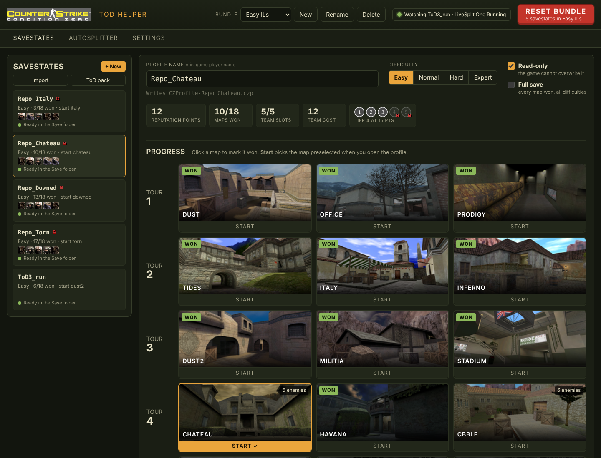
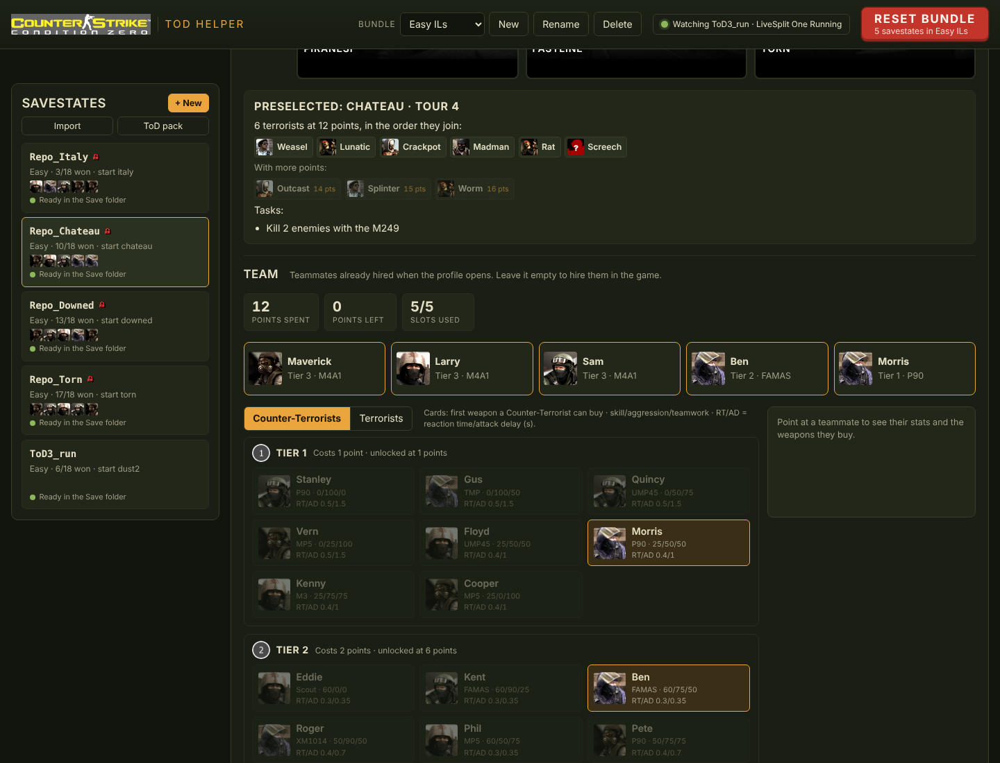
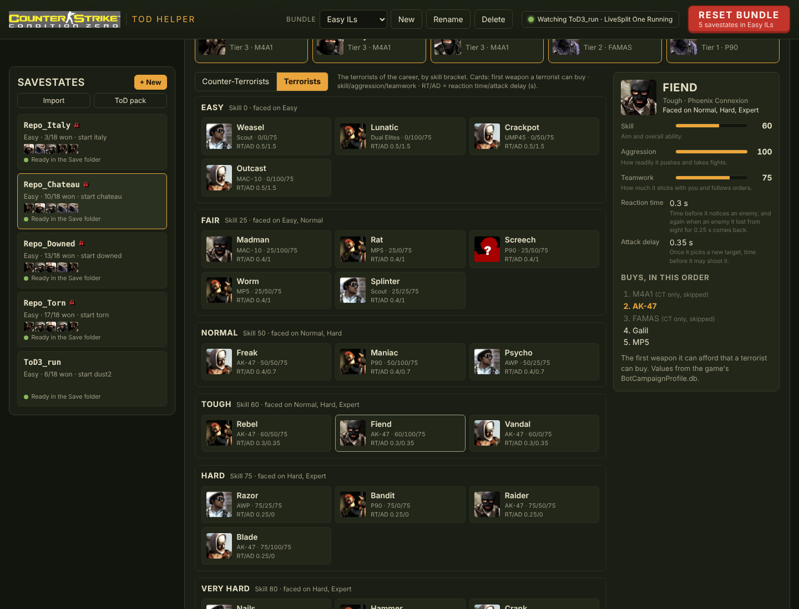
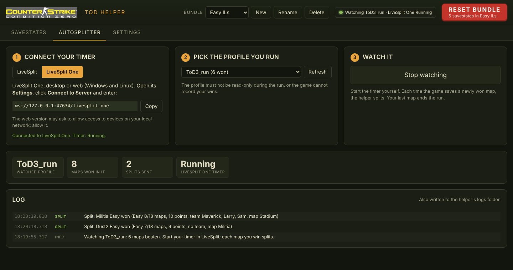

# CS:CZ ToD Helper

A helper for **Counter-Strike: Condition Zero** career speedruns (Tour of Duty), for Windows and Linux.

> **Version 0.4, in testing.** Version 1 will come once it is clean and usable for everyone.

- **Savestate builder**: pick the won maps, the preselected map and the team, and get a valid career profile.
  The game's own rules are enforced, so you cannot build a state the game would never produce.
- **Operator sheets**: every teammate's and terrorist's stats (skill, aggression, teamwork, reaction time, attack delay)
  and the weapons they buy, plus the exact terrorists you face on the preselected map.
- **Recommended ToD pack**: type your pseudo, get the 12 savestates to practice every tour and every map.
- **Bundles and the red Reset button**: keep your savestates in a bundle and put them all back to their original state
  in one click after a run.
- **Import**: turn the profiles of your Save folder (made by the game, by a friend, or by an older copy of the helper)
  into savestates.
- **Autosplitter**: watches the profile you run and splits in **LiveSplit** (Windows) or **LiveSplit One**
  (Windows, Linux, web) each time the game saves a newly won map.

It is one program with no installation. Its interface opens in your browser.



**Safe by design:** the helper only reads and writes the `CZProfile-*.czp` files of the Save folder you choose.
It never touches the game's memory, process or other files. [SECURITY.md](SECURITY.md) lists everything it does,
with the place in the code.

## Download and start

1. Get `cscz-tod-helper.exe` (Windows) or `cscz-tod-helper` (Linux) from the
   [releases](https://github.com/ValR-AI/cscz-tod-helper/releases), or [build it yourself](#build-it-yourself).
   - Windows may say "Windows protected your PC" because the program is not signed: click **More info**, then **Run anyway**.
   - Linux: run `chmod +x cscz-tod-helper` once.
2. Start it. A console window opens (keep it open: the autosplitter runs there) and the interface opens in your browser
   at `http://127.0.0.1:47634/`.
3. In **Settings**, choose your game's Save folder with **Browse** or paste its path. It is usually
   `Steam/steamapps/common/Half-Life/czero/Save`:
   - Windows: `C:\Program Files (x86)\Steam\steamapps\common\Half-Life\czero\Save`
   - Linux: `/home/<you>/.local/share/Steam/steamapps/common/Half-Life/czero/Save`

**Updating:** replace the program by the new one **in the same folder**. Your bundles and settings live in the
`cscz-tod-helper-data` folder next to it. If you start a new version from another folder, its list is empty: use
**Import** to bring your profiles back from the Save folder.

## Building savestates

- **Profile name** is also your in-game player name: 31 characters max, letters, digits and `_ - ( ) [ ] . ! @ # $ ^ & * { } | : ' < , >`.
  No space, and none of `" \ % ;`: the game refuses them in a player name and would save your career under another
  name. The file is named the way the game expects it: every character other than a letter, a digit, `_` or `-` becomes
  `_`, so `ValR_ToD1(U)` is written as `CZProfile-ValR_ToD1_U_.czp`. Two names that give the same file (`ToD1(U)` and
  `ToD1_U_`) cannot both exist: the game would mix them up.
- **Progress**: click a map to mark it won. A map counts only once every earlier tour is complete, like in the game.
  **Start** picks the map preselected when the profile opens (any map of an unlocked tour).
- **Reputation points** are always computed: the difficulty's start (Easy 2, Normal 2, Hard 6, Expert 8) plus 1 per won map.
  Each map shows how many enemies you will face with those points, and the preselected map lists the terrorists
  in the order they join (the ones that join with more points are greyed, with the points they need).
- **Team**: up to min(points, 5) teammates, whose total cost fits in your points, from the tiers your reputation has unlocked.
  The points spent and left are shown above the team. Leave it empty to hire your team in the game.
- **Read-only** makes the game unable to overwrite the profile: win the map, reload the profile, play it again.
- **Full save** marks every map of all four difficulties as won, to reach any map on any difficulty.
- **Advanced > CHEAT** lets you hire teammates from tiers your reputation has not unlocked yet. The game accepts it,
  but runs done with it are not legit.

### Teammates and terrorists



Each card shows the first weapon the bot can buy, its skill/aggression/teamwork, and its RT/AD (reaction time and attack
delay, in seconds). Point at a card to see the full sheet. The **Counter-Terrorists / Terrorists** switch above the cards
shows the terrorists of the career with the same cards, grouped by skill bracket (they cannot be hired, of course).



All values come from the game's `BotCampaignProfile.db`, combined the way the game does it (each bot inherits templates
such as `Hard+Rifle`):

- **Skill** (0-100): aim and overall ability. It also sets how long a bot needs to notice that its target died
  (1 - skill/100 seconds).
- **Aggression** (0-100): how readily it pushes and takes fights.
- **Teamwork** (0-100): how much it sticks with its team and follows orders.
- **Reaction time (RT)**: the bot acts on what it saw RT seconds ago. It notices a new enemy RT late, and again when an
  enemy it lost from sight for more than 0.25 s comes back.
- **Attack delay (AD)**: once it picks a new target, it may not shoot it before AD has passed. It comes back only with a
  new target. So the first shot comes RT + AD after you appear.
- **Weapons**: a bot tries its preferred weapons in order and buys the first one it can afford. A weapon of the other
  side fails and is skipped: Maverick prefers the AK-47, but as a Counter-Terrorist he buys the M4A1. The sheet keeps the
  whole list and marks the skipped weapons. There is no randomness in that choice; a bot only buys at random when none of
  its preferences is possible.

The terrorists of a map come from `CareerGame*.vdf`: the first *minEnemies* names of the map's list, plus one more name per
reputation point above its *threshold*. Expert Airstrip lists Wolfhound twice; a name can only be in the game once, so the
second one never plays.

## Recommended ToD pack

**ToD pack** (under the savestate list) asks for a pseudo (24 characters max) and a difficulty, then creates a new
bundle with 12 savestates, all with an empty team. For each tour n, `Pseudo_ToDn-…` has the tours before n won and the
first map of tour n preselected:

- `Pseudo_ToD1-U` to `Pseudo_ToD6-U` are writable: play the whole tour, the game records your wins.
- `Pseudo_ToD1-L` to `Pseudo_ToD6-L` are read-only: win a map, reload the profile, play it again.

Press **Reset bundle** after a run to put the U profiles back at the start of their tour.

## Import

**Import** lists the profiles of your Save folder that the bundle does not have yet, and turns the ones you pick into
savestates: difficulty, won maps, preselected map, team and read-only flag. Their files are left as they are until you
save or reset them. A profile with careers on several difficulties keeps the one it opens on (or becomes a full save when
every difficulty is complete); medals are not kept. Profiles whose name the helper does not accept (spaces, more than
31 characters...) are listed with the reason.

## Bundles and the red Reset button

A bundle is your set of savestates, kept as the reference image. Saving a savestate writes its profile into the Save
folder right away. Runs that span several maps (an individual tour, a full Tour of Duty) need the game to write to the
profile, so use savestates that are **not** read-only for them. When the run is over, press **Reset bundle**: every
savestate of the bundle is written back exactly as you built it, read-only flags included.

You can keep several bundles (for example one per difficulty) and switch between them. Two bundles holding the same
profile name write the same file: the helper warns you when that happens.

Every profile the helper writes or deletes is noted, with the time and what it contained, in
`cscz-tod-helper-data/logs/helper-<date>.log`. If the game ever misbehaves with a profile, that file tells what the helper
did at that moment.

## Autosplitter



1. Pick your timer in the **Autosplitter** tab:
   - **LiveSplit** (Windows): right-click the timer, then **Control > Start TCP Server** (default `127.0.0.1:16834`).
   - **LiveSplit One** (desktop or [web](https://one.livesplit.org), Windows and Linux): open its **Settings**, click
     **Connect to Server** and enter `ws://127.0.0.1:47634/livesplit-one`. The web version may ask to allow access to
     devices on your local network: allow it.
2. Pick the profile you run (the list shows the names written in the profiles, as the game does) and press
   **Start watching**.
3. Start the timer yourself. Each time the game saves the profile with a newly won map, the helper splits.
   Your last map ends the run.

The helper reads the watched file about 20 times per second and splits only when a map goes from not won to won:
hiring a team, changing the preselected map or pressing Reset never splits. Every save the game makes is written
to the log (also in `cscz-tod-helper-data/logs`).

## Build it yourself

You do not have to trust a downloaded program: building it takes a few minutes, and the result is byte-identical
to the release.

### Windows

1. Install Go from <https://go.dev/dl/> (the `.msi` installer, default options).
2. Get the source: on the [GitHub page](https://github.com/ValR-AI/cscz-tod-helper), **Code > Download ZIP**, then
   extract it. Or with Git: `git clone https://github.com/ValR-AI/cscz-tod-helper`.
3. Open the extracted folder, type `cmd` in the address bar and press Enter. In the window that opens, type:
   ```
   build.bat
   ```
4. Your programs are in the `dist` folder: `cscz-tod-helper.exe` for Windows, `cscz-tod-helper` for Linux.

### Linux

1. Install Go from <https://go.dev/dl/> or your distribution's packages (`golang-go`, `golang`, `go`).
2. Get the source (`git clone https://github.com/ValR-AI/cscz-tod-helper`, or download and extract the ZIP).
3. In the source folder:
   ```
   sh build.sh
   ```
4. Your programs are in `dist/`, with their SHA-256 in `dist/SHA256SUMS`.

### Same program as the release

The scripts pin the Go version (Go downloads it by itself the first time) and build with
`-trimpath -buildvcs=false -ldflags="-s -w"` without C code, so every build of the same source is identical, on any
computer. Compare your SHA-256 with the release's to prove the release is exactly this code:

- Windows: `certutil -hashfile dist\cscz-tod-helper.exe SHA256` (printed by `build.bat`)
- Linux: `sha256sum dist/cscz-tod-helper` (written to `dist/SHA256SUMS`)

To build only for your own system during development: `go build .`. To run the tests: `go test ./...`.

## Command line

Run without arguments for the interface. With arguments, it is a command-line tool, mainly for debugging and scripts:

```
cscz-tod-helper -n Repo_Italy --tours 1 --current-map italy --team floyd,morris,quincy,cooper,vern --folder "<Save>"
cscz-tod-helper -n Repo_All --complete --folder "<Save>"
cscz-tod-helper --info --folder "<Save>"
cscz-tod-helper -n Repo_Italy --unlock --folder "<Save>"
cscz-tod-helper -n Repo_Italy --watch --folder "<Save>"
cscz-tod-helper gui --port 0 --data ./my-data --no-browser
```

`cscz-tod-helper --help` lists every option. The same rules as the interface apply.

## For developers

### Game data

`internal/game/data_gen.go` (rules, map rosters, teammates and terrorists) and `internal/web/ui/img` (icons) are generated
from the game's own files (`CareerGame*.vdf`, `BotCampaignProfile.db` and a few TGA images) by a developer tool, run on
your own copy of the game:

```
go run ./tools/extract -czero "/path/to/Half-Life/czero"
```

The helper itself never reads those files: the data is built into the program.

### Project layout

```
main.go                       entry point: interface (no arguments) or command line
internal/czp                  .czp format: parse, write, checksum
internal/game                 career rules, teammates, terrorists, weapons + generated data
internal/savestate            savestate definition -> profile, rule checks, import, ToD pack, Save folder files
internal/bundle               bundles stored as JSON
internal/autosplit            profile watcher, LiveSplit TCP client, LiveSplit One WebSocket server
internal/web                  local server, JSON API, OS helpers, embedded interface (ui/)
internal/cli                  command line
internal/settings             config.json
tools/extract                 builds the game data from a game install
```

### The .czp format

Little-endian integers, zero-terminated strings:

```
char[4]  "CZP\0"
int32    campaign count (4: Easy, Normal, Hard, Expert)
string   profile name (also the in-game player name)
int32    unknown value written by the game (0 in generated profiles)
byte     current difficulty (0-3)
byte     medal per campaign [4]
per campaign:
  byte   started (0/1); when 1:
    byte    reputation points
    byte    team size, then the teammate names
    byte    map count, then per map: name, byte won (0/1)
    string  preselected map
    byte    reputation points before the last win
int32    reserved size (256), then 256 int32 set to 0
uint32   checksum = sum of byte[i] * (i + 1) over every byte before it (unsigned bytes, 32-bit)
```

The file is `CZProfile-<name>.czp`, where every character of the name other than a letter, a digit, `_` or `-` becomes
`_` (only the first 31 characters count): the game builds the file name that way when it loads or saves a profile
(`gameui.so`, `CCareerGame::LoadProfile` and `SaveProfile`), and the profile list shows the name written inside.

Maps come in groups of three: each group is a tour. To check the parser against real profiles, point
`CZP_FIXTURES` at a folder of `.czp` files and run `go test ./...`.

## License and credits

MIT License, see [LICENSE](LICENSE): free to use, modify and share, as long as the copyright notice stays.
Made by ValR66 with the help of an AI assistant (Claude, by Anthropic).

The game images and data belong to Valve and are not covered by the MIT license; see [NOTICE.md](NOTICE.md),
which also credits the work this project builds on. Counter-Strike and Condition Zero are trademarks of Valve
Corporation; this project is not affiliated with Valve.
